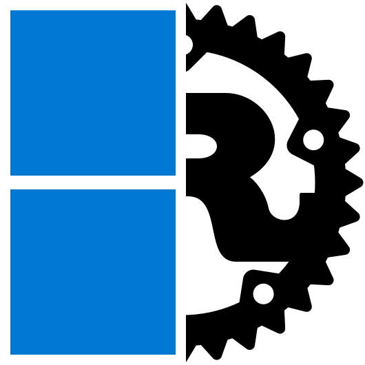

<p align="center"></p>

# WinRust

**A Windows shell written in Rust: faster and lighter than the stock one.** A set of small native programs (no .NET, no Electron) that replace parts of Windows: the taskbar, File Explorer, file search, Task Manager and a disk cleaner. One installer puts them in, one click takes them out.

English | [Русский](README.ru.md)

<p align="center"></p>

## Benchmark

One-off measurements on one machine (Windows 11 IoT Enterprise 10.0.26300, RTX 4060 Laptop, NTFS). Treat them as orders of magnitude, not lab numbers.

| What | Windows | WinRust | Difference |
|---|---|---|---|
| File search (rust-search over all of C: vs `dir /s` over one folder) | 8,340 ms | 45 ms | **99.5%** faster |
| Same vs `Get-ChildItem -Recurse` | 16,200 – 28,600 ms | 45 ms | **99.7–99.8%** faster |
| Open a folder window (rust-explorer, median of 5 runs) | 420 ms | 60 ms | **86%** faster |
| Shell memory (topbar + rust-explorer + rs-shell + reshell vs explorer.exe) | 366 MB | 46 MB | **87%** less |
| Same, plus the search index (53 MB) | 366 MB | 99 MB | **73%** less |
| File manager binary size | 3,280 KB | 498 KB | **85%** smaller |
| Task manager binary size | 5,791 KB | 869 KB | **85%** smaller |
| Idle CPU of the bar (topbar after optimization, % of one core) | 0.00–0.10% (explorer) | 0.05–0.10% | on par with Explorer |

In short: **85–99% faster or smaller in every size/speed test, and equal on idle CPU.** Caveats: rs searches a ready-made MFT index (it pays 53 MB of memory for that), while `dir` and PowerShell walk the disk from scratch; explorer.exe was still running with its windows during the test, so the memory gain is slightly overstated; Windows Search and the stock Task Manager were not compared.

## Install

Download `WinRust.exe` from the [latest release](https://github.com/Lemxy/WinRust/releases/latest), run it as administrator and press "Install WinRust" (the installer is in English by default; the **Русский** button in its corner, or "Language" in the bar's right-click menu, switches to Russian, and the other WinRust programs pick the choice up when they start). "Remove all" rolls everything back. Windows 10/11, x64.

> **Read this first.** WinRust disables Windows Search, replaces the taskbar and can replace the shell. The exe is not code-signed, so SmartScreen will warn. A restore point is created before install, but try it on a spare machine or a VM first.

## What it is

One exe (`plugin-launcher.exe`) that installs and removes our plugins on Windows. Administrator rights are required. In the window all plugins are grouped into one WinRust set: the "Install WinRust" button installs what is missing, in order (topbar before rust-explorer), and updates when everything is already there; "Remove all" rolls back. One plugin at a time: see the command line below.

| Plugin | What it does |
|---|---|
| rust-search | file search over NTFS (Alt+Space); disables Windows Search |
| rtaskmgr-win32 | replaces Task Manager |
| topbar | a bottom bar in the Windows 11 style instead of the taskbar (smooth rounded corners, tooltips above buttons, volume on the mouse wheel with a level readout). It installs together with desktop hotkeys (reshell: Win+1/2/3, Win+`) and a block in the PowerShell profile (`src/profile.ps1`: zoxide, grep=rg, ll=eza, cat=bat; written to Windows PowerShell 5.1 and to pwsh 7 if present; silent without rg/eza/bat/zoxide). Uninstalling topbar removes the block. |
| rs-du | disk cleaner (MFT analysis, caches, `target`/`node_modules`, recycle bin). It has no card of its own: it is installed into the Task Manager folder together with rtaskmgr-win32 or topbar and starts from the bar menu (right-click an empty spot → "Disk cleaner"). Sources: `plugins/rs-du` |
| chrome-rs | placeholder |
| rs-shell | its own shell instead of explorer.exe for one user logon: wallpaper, autostart (Run and Startup), starts and restarts topbar, hands the session back to explorer.exe if topbar keeps crashing. Placed next to `topbar.exe`; `rs-shell --dry-run` shows what it would start; `--enable` / `--disable` turn it on and off (HKCU only, other users are untouched). Not installed by the launcher yet. Sources: `plugins/rs-shell` |
| rust-explorer | **A launcher plugin.** A Rust file manager in the Windows style instead of File Explorer: a left pane (quick access, drives), "Name / Date / Type / Size" columns, tabs, dark theme. Installing it makes folders and drives open in it (HKCU), starts `rs-shell --overlay` at logon and **turns off the regular explorer.exe** as the shell (AutoRestartShell=0; Explorer exits once topbar and the desktop are up; if topbar does not hold, Explorer comes back by itself). Needs topbar. Uninstall reverts everything. Features: virtual list, icons, tabs (Ctrl+T/W/Tab), copy/paste/delete via IFileOperation, the shell context menu, drag and drop. Not done: thumbnails, address bar, registering as the folder handler, stages 2-5 of the plan (index, shell, tray, Shell Launcher). |

## Layout
```
src/            the launcher (window + install logic)
payload/        built plugin exes, embedded into the launcher at build time (not in git)
plugins/        sources: rust-search, rtaskmgr-win32, topbar, rust-explorer, rs-shell, rs-du, ... (each is its own cargo project)
scripts/        build-all.ps1: syncs plugins/ with the originals, rebuilds, refreshes payload/ and STAMPS.txt; sync.ps1 -Check: drift check (run with -ExecutionPolicy Bypass)
ROADMAP.md      plans
```

## Build
```powershell
.\scripts\build-all.ps1
```
Result: `target\release\plugin-launcher.exe`. Close a running launcher before building. Note: `build-all.ps1` currently syncs `rust-search` and `rtaskmgr-win32` from the author's own working folders (see `scripts\sync.ps1`), so a clean clone needs that step adapted.

## Command line
From a terminal **with administrator rights**:
```
plugin-launcher list
plugin-launcher install <plugin> --yes   (without --yes it only prints the warning and changes nothing)
plugin-launcher update <plugin>          (reinstall from payload\ next to the exe, no launcher rebuild; see scripts\update-plugin.ps1)
plugin-launcher uninstall <plugin>
plugin-launcher rollback --yes
```
Exit codes: 0 success, 1 error, 2 bad arguments or no `--yes`. With no arguments the window opens.

## New plugin
One entry in `PLUGINS` (`src/main.rs`): name, description, warning, `installed`, an install/uninstall function pair and a `glyph` icon. The window, the list height and the CLI pick it up on their own.
